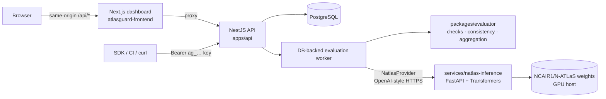

# AtlasGuard

**Engineering Trust in Nigerian AI.**

AtlasGuard is open-source developer infrastructure for evaluating applications built on
**N-ATLaS** (`NCAIR1/N-ATLaS`), Nigeria's multilingual language model. It runs reproducible
benchmark evaluations in **Nigerian English, Yoruba, Hausa and Igbo**, records every actual
model response, and detects answers that change meaning between languages.

> N-ATLaS is an initiative of the Federal Ministry of Communications, Innovation and Digital
> Economy, and powered by Awarri Technologies.

Built for the National AI Innovation Challenge 2026 — Developer Infrastructure track.

---

## The problem

* A model can answer correctly in English and incorrectly — or incompletely — in Yoruba,
  Hausa or Igbo, and developers rarely measure the difference.
* Equivalent questions in different languages can receive *different facts*, eroding trust.
* Generic evaluation tools ignore Nigerian terminology, Nigerian English and local context.
* Teams write throw-away evaluation scripts whose results cannot be reproduced or compared.

## The solution

| Capability | What AtlasGuard does |
|---|---|
| **Multilingual evaluation engine** | Executes benchmark suites against N-ATLaS in a background worker, stores each prompt, response, latency and check, and assigns explicit verdicts (`PASSED`, `FAILED`, `NEEDS_REVIEW`, `ERROR`, `SKIPPED`). |
| **Nigerian context benchmarks** | 14 semantic groups × 4 languages (57 cases) across financial terminology, Nigerian English, education, civic information, culture and meaning preservation — with provenance and review status on every case, JSON import/export and a reviewer workflow. |
| **Cross-language consistency detection** *(signature)* | Aligns reference facts across the language variants of a question and separates confirmed contradictions (different numbers or entities) from omissions and from findings that need a fluent reviewer. |
| **Developer API & SDK** | Documented REST API (OpenAPI/Swagger), API keys, and a typed TypeScript SDK (`@atlasguard/sdk`). |
| **Dashboard & reports** | Overview, projects, benchmarks, live evaluation progress, per-case inspection, language insights, run comparison, JSON/CSV/Markdown exports and an N-ATLaS integration-evidence bundle. |

**Integrity by design:** simulated fixture runs are labelled everywhere and can never be
exported as N-ATLaS evidence; AtlasGuard never substitutes another model; technical errors
are never counted as model failures; uncertain judgements go to human review; AI-drafted
translations stay *pending review* until a fluent speaker verifies them.

## Architecture



| Path | Contents |
|---|---|
| `apps/api` | NestJS 11 REST API, Prisma schema & migrations, worker, reports |
| `packages/shared` | Shared domain types, constants and the Zod benchmark-dataset schema |
| `packages/evaluator` | Evaluation checks, language identification, consistency engine, aggregation, `NatlasProvider`, fixture provider |
| `packages/benchmarks` | Datasets, JSON Schema, validation scripts, simulated fixtures |
| `packages/sdk` | `@atlasguard/sdk` TypeScript client |
| `services/natlas-inference` | Python inference service for the official N-ATLaS weights (+ Kaggle/Colab notebook, Dockerfile) |
| `docs/` | Architecture, setup, API reference, testing guide, methodology, N-ATLaS integration, benchmarking, deployment, submission |
| [atlasguard-frontend](https://github.com/kobiowuquadri/atlasguard-frontend) | Next.js 16 dashboard (separate repository) |

More detail: [docs/architecture.md](docs/architecture.md).

## Technology

TypeScript everywhere except model inference. **API:** Node.js 24, NestJS 11, Prisma 6,
PostgreSQL 17, class-validator, Zod 4, Swagger, Helmet, argon2id. **Dashboard:** Next.js 16
(App Router), React 19, Tailwind CSS 4, Radix-based shadcn-style components, TanStack Query,
React Hook Form, Recharts, Lucide. **Inference:** Python, FastAPI, Hugging Face Transformers,
PyTorch. **Tests:** Vitest, Supertest, Playwright, pytest. **Tooling:** pnpm 10 workspaces.

Version choices are deliberate: NestJS 11 (the maintained `legacy` line) instead of the
ESM-only NestJS 12 released in September 2026, Prisma 6.19, and TypeScript 5.9 (TypeScript 7's
native compiler is not yet supported by the build tooling).

## Quick start (local)

Prerequisites: **Node.js ≥ 22.12** (24 recommended) and **pnpm 10** (`npm i -g pnpm@10`).
PostgreSQL is optional — the repo can run a real PostgreSQL 17 for you without Docker or
admin rights.

```bash
git clone https://github.com/kobiowuquadri/atlasguard-backend.git
cd atlasguard-backend
pnpm install
pnpm db:start                       # terminal 1: local PostgreSQL on :54329 (keeps running)

cp apps/api/.env.example apps/api/.env
pnpm build:packages
pnpm db:migrate                     # creates the schema
pnpm dev:api                        # terminal 2: API on http://localhost:4000 (docs: /api/docs)
```

The official benchmark suite is imported automatically on first start (`pnpm db:seed`
does the same explicitly). Then start the dashboard from [atlasguard-frontend](https://github.com/kobiowuquadri/atlasguard-frontend):

```bash
git clone https://github.com/kobiowuquadri/atlasguard-frontend.git
cd atlasguard-frontend
pnpm install
cp .env.example .env.local          # ATLASGUARD_API_URL=http://localhost:4000
pnpm dev                            # http://localhost:3000
```

Without an N-ATLaS endpoint you can explore the product with the **Development fixtures**
configuration (clearly labelled *Simulated*). To evaluate the real model, follow
[docs/natlas-integration.md](docs/natlas-integration.md) — in short: accept the model terms
on Hugging Face, run `services/natlas-inference/notebooks/natlas_inference_gpu.ipynb` on a
Kaggle GPU, and put the printed `NATLAS_BASE_URL` / `NATLAS_API_KEY` in `apps/api/.env`.

Full setup, environment reference and troubleshooting: [docs/setup.md](docs/setup.md).

## Commands

| Command | Purpose |
|---|---|
| `pnpm db:start` | Local PostgreSQL 17 (embedded; UTF-8) on port 54329 |
| `pnpm build` / `pnpm build:packages` | Build everything / only the shared packages |
| `pnpm dev:api` | API with watch mode |
| `pnpm db:migrate` · `pnpm db:seed` | Apply migrations · import official benchmarks |
| `pnpm test` | All TypeScript test suites (API integration tests start their own PostgreSQL) |
| `pnpm typecheck` | Type-check every package |
| `pnpm benchmarks:validate` | Validate datasets and print review statistics |
| `pnpm smoke:natlas` | **Real** N-ATLaS smoke test (needs `NATLAS_BASE_URL`) |
| `cd services/natlas-inference && pytest` | Inference-service tests (fake backend) |

## Tests

| Suite | Scope |
|---|---|
| `packages/evaluator` (84) | numbers, folding, language identification, fact checks, case verdicts, consistency (matching facts, missing facts, numeric/entity contradictions, missing responses, uncertainty), aggregation, **mocked** provider behaviour (timeouts, auth, retries, malformed output, model mismatch, concurrency) |
| `packages/shared` (7), `packages/benchmarks` (23) | dataset schema rules, dataset integrity, fixture verdicts |
| `apps/api` (42) | integration tests on real PostgreSQL: auth, CSRF, isolation, API keys, imports, reviews, full worker runs, crash recovery, cancellation, human review, provider failures, evidence export, reports, OpenAPI |
| `packages/sdk` (12 + 1 live) | mocked client behaviour + a live end-to-end run |
| `services/natlas-inference` (9 + 1) | HTTP contract with a fake backend + the real Transformers path on a tiny public Llama (opt-in) |
| Dashboard (Playwright, 2) | sign-up → project → benchmark → evaluation → results → consistency → CSV export; protected routes |

Provider tests marked *mocked* never contact N-ATLaS; only `pnpm smoke:natlas` and real runs do.

## API and SDK

* Swagger UI: `http://localhost:4000/api/docs` · OpenAPI JSON: `/api/docs-json` · snapshot:
  [docs/openapi.json](docs/openapi.json) · guide: [docs/api.md](docs/api.md)
* Responses: `{ "success": true, "data": … , "meta"? }` or
  `{ "success": false, "error": { "code", "message", "requestId" } }`

```ts
import { AtlasGuard } from '@atlasguard/sdk';

const atlas = new AtlasGuard({ baseUrl: process.env.ATLASGUARD_BASE_URL!, apiKey: process.env.ATLASGUARD_API_KEY! });
const run = await atlas.evaluations.run({ projectId, suiteId: 'nigerian-context-v1', languages: ['en-NG', 'yo'] });
const result = await atlas.evaluations.waitForCompletion(run.id);
console.log(result.summary?.overall.verifiedPassRate);
```

The SDK is not published to npm yet; see [packages/sdk/README.md](packages/sdk/README.md)
for installing it from this repository.

## Deployment

API on any Node.js host (Render/Railway/VPS) with managed PostgreSQL, dashboard on Vercel,
N-ATLaS on a GPU host. Step-by-step: [docs/deployment.md](docs/deployment.md).

## Known limitations

* **The benchmark content is an AI-assisted draft pending review by fluent speakers**; no
  case is marked verified yet. Results are indicative until reviewers verify the cases.
* Automated checks are lexical and numeric (see
  [docs/evaluation-methodology.md](docs/evaluation-methodology.md)); concept-level answers
  rely on human review.
* N-ATLaS must be self-hosted (no hosted provider exists). Free GPU notebooks and quick
  tunnels are temporary; production use needs a stable GPU host.
* The worker processes cases with bounded concurrency in the API process; very large suites
  would benefit from a dedicated worker deployment (supported: run more API instances —
  runs are claimed with `FOR UPDATE SKIP LOCKED`).
* Only English, Yoruba, Hausa and Igbo are supported; new languages require lexicons,
  benchmark content and tests first.

## Licensing and attribution

AtlasGuard's source code is released under the [MIT licence](LICENSE). This licence does
**not** cover N-ATLaS: the model weights are distributed by NCAIR1 under the N-ATLaS licence
(including a 1,000 active-user cap without a commercial licence and attribution
requirements) and are never redistributed by this repository.

*N-ATLaS is an initiative of the Federal Ministry of Communications, Innovation and Digital
Economy, and powered by Awarri Technologies.* AtlasGuard is an independent project and is
not affiliated with Awarri Technologies or the Federal Ministry.
