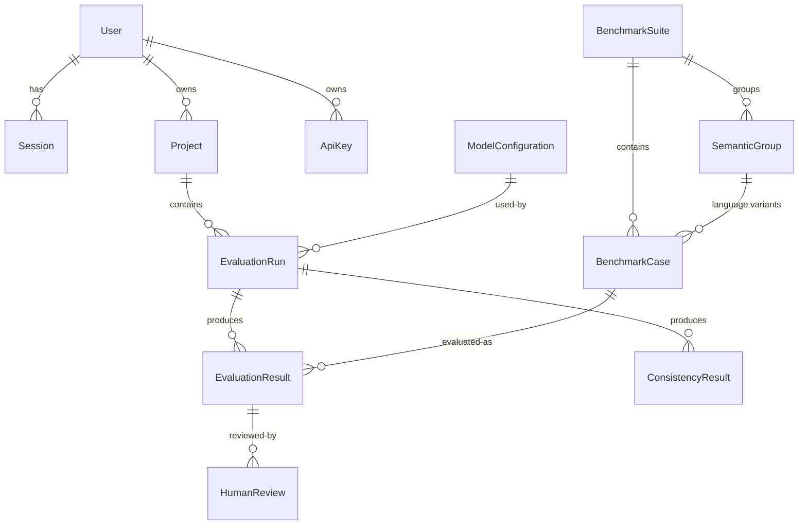

# Architecture

## Components

| Component | Technology | Responsibility |
|---|---|---|
| Dashboard ([atlasguard-frontend](https://github.com/kobiowuquadri/atlasguard-frontend)) | Next.js 16, React 19, Tailwind 4, TanStack Query | UI. Calls the API through a same-origin proxy (`/api/*` rewrite) so the session cookie is first-party and the API URL never reaches the browser. `proxy.ts` redirects signed-out users away from dashboard routes. |
| API (`apps/api`) | NestJS 11, Prisma 6, PostgreSQL | Authentication, projects, benchmarks, evaluation runs, consistency analysis, reports, API keys, insights, beta feedback. Hosts the evaluation worker. |
| Evaluator (`packages/evaluator`) | TypeScript, no framework | Pure, unit-tested logic: text folding, number extraction, language identification, fact/instruction/latency checks, verdicts, cross-language consistency, aggregation, `NatlasProvider` and fixture provider. |
| Shared (`packages/shared`) | TypeScript, Zod | Domain types, constants, dataset schema + validator. |
| Benchmarks (`packages/benchmarks`) | JSON + scripts | Official datasets, generated JSON Schema, simulated fixtures, validation CLI. |
| SDK (`packages/sdk`) | TypeScript, fetch | Typed client for scripts and CI. |
| Inference service (`services/natlas-inference`) | Python, FastAPI, Transformers | Serves the official N-ATLaS weights. Inference only — no users, no business logic, no persistence. |

## Request and data flow

```mermaid
sequenceDiagram
  participant U as Developer (dashboard or SDK)
  participant A as AtlasGuard API
  participant D as PostgreSQL
  participant W as Worker (in the API process)
  participant N as N-ATLaS inference service

  U->>A: POST /evaluations/runs {project, suite, languages, parameters}
  A->>N: GET /health (provider must be available)
  A->>D: create EvaluationRun (QUEUED) + one EvaluationResult per case (PENDING, case snapshot)
  A-->>U: 201 run
  W->>D: claim run (UPDATE … FOR UPDATE SKIP LOCKED) → RUNNING, heartbeat
  W->>N: GET /health, /v1/models, /model-info → provenance stored on the run
  loop each pending case (bounded concurrency)
    W->>D: claim case (PENDING → RUNNING, attempts+1)
    W->>N: POST /v1/chat/completions
    N-->>W: response + usage + generation time + revision
    W->>W: evaluateCase (validity, language, facts, instructions, latency)
    W->>D: store response, checks, verdict (DONE); refresh run counters
  end
  W->>D: consistency per semantic group; summary; COMPLETED
  U->>A: GET /evaluations/runs/:id, /results, /consistency, /reports/:id/export
```

## Evaluation execution and reliability

* **Queue.** Runs live in PostgreSQL; there is no separate broker. A worker claims the oldest
  queued run — or a running run whose heartbeat is older than `WORKER_STALE_AFTER_MS` — with
  a single `UPDATE … WHERE id = (SELECT … FOR UPDATE SKIP LOCKED)`, so several API instances
  can share the queue safely.
* **No double counting.** Results are unique per `(run, case)`; each case is claimed with a
  conditional update (`PENDING → RUNNING`); counters and summaries are recomputed from the
  stored results rather than incremented.
* **Recovery.** On reclaim, cases stuck in `RUNNING` return to `PENDING`; cases interrupted
  `CASE_MAX_ATTEMPTS` times become `ERROR`; a run interrupted more than five times fails.
* **Cancellation.** Queued runs cancel immediately; running runs stop before the next case.
  Unrun cases become `SKIPPED`.
* **Circuit breaker.** Three consecutive availability failures (timeouts, 5xx, rate limits),
  any authentication failure, or a model mismatch stop the run (`FAILED`) instead of
  burning through the remaining cases; remaining cases are `SKIPPED`.
* **Shutdown.** In-flight requests are aborted and their cases return to `PENDING`; the
  heartbeat stops, so another worker (or the restarted process) resumes the run.
* **Time.** All timestamps are UTC, including the raw SQL claim (explicit
  `AT TIME ZONE 'UTC'`), so the worker is correct on databases whose time zone is not UTC.

## Model integration

See [natlas-integration.md](natlas-integration.md). The API talks to N-ATLaS only through
`NatlasProvider`, configured from server environment variables. Model configurations
(`ModelConfiguration` rows) reference endpoints symbolically (`env:NATLAS`,
`fixture:builtin`) and are synchronised from configuration at boot; users cannot supply
endpoint URLs.

## Persistence



* JSON columns are used only for variable structures: fact definitions, rules, provenance,
  check results, provider metadata and summaries. Relationships are relational with
  foreign keys and indexes on query paths.
* History is immutable: projects are archived (not deleted), cases referenced by results
  cannot be hard-deleted, results snapshot the case they evaluated, and runs record the
  benchmark version and content hash.
* The database must use UTF-8 (Yoruba/Igbo/Hausa text and ₦); the API refuses to start on
  another encoding.

## Security boundaries

| Concern | Control |
|---|---|
| Passwords | argon2id (19 MiB, t=2, p=1); timing-equalised login; generic error message |
| Sessions | 256-bit opaque token in an `HttpOnly`, `SameSite=Lax` (and `Secure` in production) cookie; only its SHA-256 is stored; logout deletes it |
| CSRF | SameSite cookies + an Origin/Referer allow-list for cookie-authenticated state changes |
| API keys | `ag_` + 192-bit secret, shown once; HMAC-SHA256 with a server pepper stored; optional project scope; cannot manage keys or sessions |
| Authorisation | every project, run, result and report lookup is scoped to the owner (404 for others); official benchmark review is admin-only |
| Input | global `ValidationPipe` (whitelist + forbid unknown fields), Zod for datasets, 2 MB body limit, no regular expressions from datasets (phrases are escaped) |
| Abuse | rate limits (global 300/min; register 5/min; login 10/min; run creation 20/min) |
| Transport/headers | Helmet (nosniff, frame denial, HSTS in production), strict CORS allow-list, `x-powered-by` removed |
| SSRF | model endpoints come only from server configuration; redirects are refused |
| Logging | structured JSON access logs with request ids; no headers, cookies, bodies or keys are logged; provider error bodies are redacted of the endpoint key |
| Errors | consistent `{ success: false, error: { code, message, requestId } }`; unexpected errors return a generic message |
