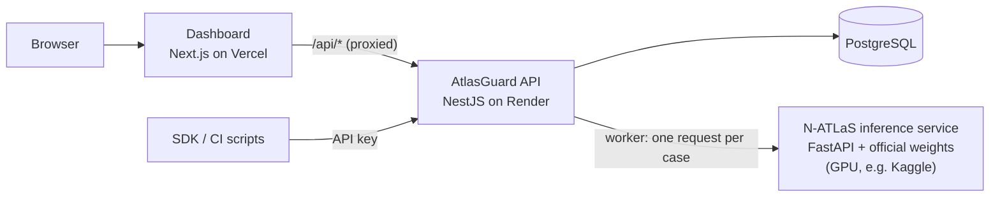

# AtlasGuard — system overview and testing guide

This guide is for anyone joining the project to understand AtlasGuard and test it. Part A
explains the system; Part B is a test plan you can follow on the live deployment or on your
own machine.

---

## Part A — Understanding the system

### What AtlasGuard does

AtlasGuard is evaluation infrastructure for **N-ATLaS**, Nigeria's multilingual LLM
(`NCAIR1/N-ATLaS`, Llama-3 8B, English · Yoruba · Hausa · Igbo). It sends benchmark questions
to the model in four languages, records every actual response, scores each one with
transparent rule-based checks, and — its signature feature — **compares the answers to the same
question across languages** to catch facts that change from one language to another
(e.g. a bank-transfer total of ₦5,050 in English but ₦4,950 in Yoruba).

### Architecture



| Repository | Contains |
|---|---|
| `atlasguard-backend` | `apps/api` (REST API + evaluation worker), `packages/evaluator` (checks, consistency analysis, N-ATLaS client), `packages/benchmarks` (the Nigerian Context Benchmark), `packages/shared`, `packages/sdk` (TypeScript SDK), `services/natlas-inference` (Python service that serves the model) |
| `atlasguard-frontend` | The Next.js dashboard |

### Key concepts

| Term | Meaning |
|---|---|
| **Project** | An AI application being evaluated; runs belong to projects |
| **Benchmark suite** | A versioned set of test cases (official: *Nigerian Context Benchmark*, 57 cases) |
| **Semantic group** | The same question in several languages, sharing language-independent **reference facts** (e.g. "total deducted = ₦5,050") |
| **Case** | One language variant: prompt, reference facts, rules, provenance and **review status** |
| **Run** | One evaluation of a suite against a model; cases execute in the background |
| **Verdict** | Per case: `PASSED`, `FAILED` (a deterministic check failed), `NEEDS_REVIEW` (could not be decided automatically), `ERROR` (technical — never counted as a model failure), `SKIPPED` |
| **Verified pass rate** | PASSED ÷ (PASSED + FAILED) — review, errors and skipped cases are excluded and shown separately |
| **Cross-language consistency** | Per semantic group: a **confirmed contradiction** (languages state different values), an **omission** (a fact missing in one language) or a finding that **needs a fluent reviewer** |
| **Human review** | A reviewer's PASSED/FAILED decision overrides the automated verdict and is recorded with their name |
| **Simulated run** | Uses hand-written *development fixtures* instead of the model (local development only). Always labelled *Simulated*, never counted or exported as N-ATLaS evidence |
| **Evidence bundle** | A signed (SHA-256) export of a real run: every prompt, response, request id, timing and the model's provenance |

### Integrity rules the product enforces

* Simulated output is never presented as N-ATLaS output; fixtures cannot be enabled in production.
* If N-ATLaS is unreachable, runs refuse to start — AtlasGuard never substitutes another model.
* AI-drafted benchmark translations stay *Pending review* until a fluent speaker verifies them.
* Technical errors are reported separately and never counted as model failures.

---

## Part B — Testing

### Option 1: the live deployment (recommended)

You need the dashboard URL from the project owner — sign up with any email. Running
evaluations needs the N-ATLaS GPU endpoint to be online: check **Settings → N-ATLaS
connection** (or the *Model* card in the sidebar) before starting a run, and ask the owner to
start it if it shows *Unavailable*.

### Option 2: on your machine (developers)

Prerequisites: Node.js 24, pnpm 10 (`npm i -g pnpm@10`), git, and access to both repositories.
No Docker, PostgreSQL or GPU needed.

```bash
# API (terminal 1 and 2)
git clone https://github.com/kobiowuquadri/atlasguard-backend.git && cd atlasguard-backend
pnpm install
pnpm db:start                           # terminal 1 — embedded PostgreSQL 17, leave running
cp apps/api/.env.example apps/api/.env
pnpm build:packages && pnpm db:migrate
pnpm dev:api                            # terminal 2 — http://localhost:4000 (Swagger: /api/docs)

# Dashboard (terminal 3)
git clone https://github.com/kobiowuquadri/atlasguard-frontend.git && cd atlasguard-frontend
pnpm install && cp .env.example .env.local
pnpm dev                                # http://localhost:3000
```

Locally there is no N-ATLaS endpoint unless you connect one, so choose the **Development
fixtures** configuration when starting a run: the run is labelled *Simulated* and exercises
the whole pipeline without a GPU. (To connect the real model, see
[natlas-integration.md](natlas-integration.md).)

### Manual test plan

Work through these in order; each step lists what you should see.

| # | Area | Steps | Expected |
|---|---|---|---|
| 1 | Sign-up | Open the site → **Get started** → create an account | You land on *Overview* with "Welcome to AtlasGuard, *name*" and a 4-step *Get set up* card |
| 2 | Route protection | Sign out (account menu, bottom of the sidebar), open `/evaluations` | Redirected to the login page; signing in returns you to `/evaluations` |
| 3 | Projects | *Projects* → **New project** → name + description → **Create project** | The project page opens; it shows no runs yet |
| 4 | Benchmarks | *Benchmarks* → **Nigerian Context Benchmark** → open any case | Prompt, reference facts, rules and provenance; status *Pending review*; translations marked *AI-generated translation* |
| 5 | Start a run | *New evaluation* → pick your project, the benchmark, all four languages, **N-ATLaS** (live) or **Development fixtures** (local — tick *I understand this run is simulated*) → **Start evaluation** | The run page shows live progress (striped bar, verdicts filling in); a simulated run shows a yellow *Simulated run* notice |
| 6 | Results | When *Completed*, expand a few cases | Prompt sent, the actual response, each check with explanation and evidence, latency, served model, request id |
| 7 | Cross-language | **Cross-language** tab | A consistency map (groups × languages); groups with contradictions show the differing values per language, e.g. `numeric_conflict` |
| 8 | Human review | Expand a *Needs review* case → add a note → **Mark passed** or **Mark failed** | A *Reviewed* badge; the case's final verdict and the run's numbers update; your name appears in the review history |
| 9 | Insights | *Language Insights* (toggle **Include simulated runs** for local runs) | Per-language cards, *Verified pass rate by language*, and the category × language heatmap; languages without data read *Not yet evaluated*, never 0% |
| 10 | Reports | *Reports* → pick the run → **CSV**, **JSON**, **Markdown**; then *Compare runs* with two runs of the same suite | Files download (simulated runs have `-SIMULATED` in the name); the comparison shows per-language deltas and changed verdicts |
| 11 | Evidence | Run page → **Export → N-ATLaS integration evidence** | Works only for completed real N-ATLaS runs; disabled for simulated runs |
| 12 | Developer API | *Developer API* → **Create key** (copy it — shown once) → run the commands below | `/auth/me` returns your user with `"authMethod": "api_key"`; the run list matches the dashboard; after **Revoke**, the same call returns `401` |
| 13 | Search & shortcuts | Press **Ctrl K** (⌘K on Mac) anywhere in the dashboard | A command palette with pages, actions, projects and recent runs |
| 14 | Feedback | *Beta feedback* (account menu) → fill in, tick consent → submit | "Thank you" confirmation |

API commands for step 12 (replace the host and key):

```bash
BASE=https://<dashboard-host>/api/v1          # locally: http://localhost:4000/api/v1
KEY=ag_…
curl -s "$BASE/auth/me" -H "Authorization: Bearer $KEY"
curl -s "$BASE/evaluations/runs?pageSize=5" -H "Authorization: Bearer $KEY"
curl -s "$BASE/model/status"                  # public
```

The full API reference is [api.md](api.md); interactive docs are at `/api/docs` on the same host.

### Things worth trying to break

* Start a run while N-ATLaS is offline → it must be refused with a clear message (never a silent fallback).
* Use an API key on a session-only endpoint (`GET /api-keys`) → `403`.
* A project-scoped key reading another project → `404`.
* Very long or empty inputs in forms → inline validation messages, no crash.
* Phone-width browser (≈400 px) → every page usable.

### Automated tests (developers)

```bash
# atlasguard-backend
pnpm typecheck && pnpm test                    # ~180 tests; API tests start their own PostgreSQL on :54330
pnpm benchmarks:validate                       # benchmark dataset integrity
cd services/natlas-inference && pip install -r requirements-dev.txt && pytest tests/test_api.py

# atlasguard-frontend (API running with fixtures, dashboard on :3000)
pnpm typecheck && pnpm build
pnpm test:e2e                                  # Playwright: sign-up → project → run → results → reports
```

### Reporting a problem

Send: what you did (steps), what you expected, what happened, a screenshot, the page URL, and —
for errors — the **request id** shown in the error (or the `x-request-id` response header) and
the run id if it concerns a run. Never include passwords, API keys or the N-ATLaS endpoint key.
